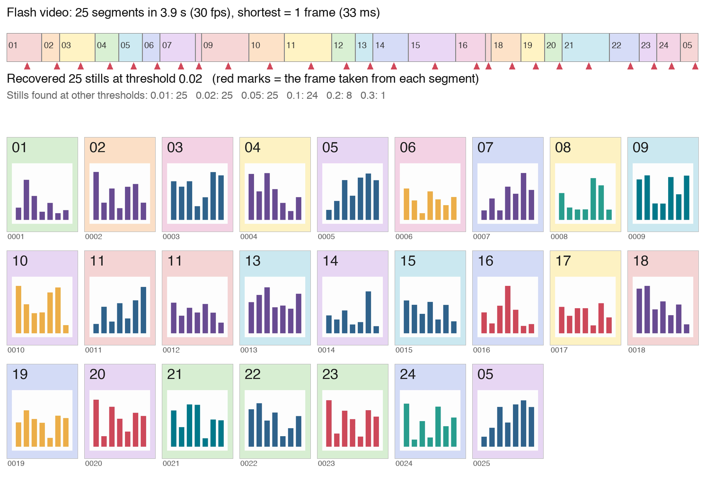

# 抖音主页归档与快闪拆图

这是 [Plot Is All You Need](../../README.md) 收集参考图用的工具。下载到的图只能放进本机不上传的 `gallery-local/`；要放进公开的 `gallery/`，先看 [THIRD_PARTY_NOTICES.md](../../THIRD_PARTY_NOTICES.md)。

把一个**你有权归档**的抖音主页完整存到本地，并把"快闪图集视频"（几秒钟里闪过几十上百张图的那种）拆回一张张原尺寸的图片。

- 图集作品：直接保存原图。
- 视频作品：保留原视频，再逐帧检测，把每一张停留过的画面各取一帧，存成原尺寸 PNG。
- 全程可中断、可重跑；登录信息只留在本机。

## 效果演示



上图由 `python demo.py` 生成，完全离线，不联网、不需要账号，用的是脚本自己画的 24 张示意图：

- 把它们剪成一段 3.9 秒的快闪视频，共 25 段内容；
- 其中两张只出现 1 帧（33 毫秒），一张在结尾再次闪过，还有相邻两张只有柱子不同、底色和编号一样；
- 用和正式流程相同的拆图函数处理，**25 段拆出 25 张**，每张都取自对应的那一段（红色三角是取帧位置）。

图中第三行是不同阈值下拆出的张数：0.05 及以下都是 25 张，0.1 漏掉 1 张，0.2 只剩 8 张。这就是为什么正式使用前要先校准阈值。

## 方法

1. **枚举**：通过 [f2](https://github.com/Johnserf-Seed/f2) 调用主页作品列表接口，逐页读取。游标没有前进、返回空列表、缺字段，都按失败处理，不会把残缺的列表当成"全部"。
2. **下载**：直接用列表里的媒体地址，不为每条作品再请求一次详情。两路并发、有限重试；视频下载后做一次完整解码，图片做一次解码检查，通过了才记为成功。重下的文件先写 `.part`，损坏的原件改名保留。
3. **拆图**：用 FFmpeg 逐帧算三样东西——场景变化分数、亮度差、色度差。任何一项超过阈值就切一刀；每一段里找最长的"画面稳定区间"，取它正中间那一帧。
   - 不设最短停留时间，只出现一帧的内容也会保留。
   - 不跨段去重，再次出现的画面会再存一张。
   - 一段里找不到稳定区间，或者有没被切开的明显变化，就在报告里标"待核对"。
4. **校准**：先只下载三条样本，分别用 0.01、0.02、0.05、0.1、0.2、0.3 六个阈值拆一遍，生成编号预览图。你对照原视频逐一核对，选出三条都正确的最高阈值并记录下来，之后才允许全量运行。
5. **人工选帧**：带缩放、旋转、闪光的视频自动检测不可靠，可以在 `frame_overrides.json` 里直接写出要取的时间点。

## 安装

需要 Python 3.10+ 和 FFmpeg（macOS：`brew install ffmpeg`）。

```sh
python -m venv .venv
.venv/bin/pip install -r requirements.txt
```

## 用法

```sh
# 1. 读取浏览器里你自己的抖音登录状态，只保存在本机
.venv/bin/python douyin_archive.py cookies --browser chrome

# 2. 枚举主页，下载三条样本（--sample-id 可指定一条最难拆的快闪视频）
.venv/bin/python douyin_archive.py sample --user "https://www.douyin.com/user/<主页ID>" --sample-id <作品ID>

# 3. 用六个阈值各拆一遍样本，生成预览
.venv/bin/python douyin_archive.py calibrate

# 4. 对照原视频核对预览后，记录通过的阈值
.venv/bin/python douyin_archive.py accept --threshold 0.02

# 5. 全量下载、全量拆图、查看进度
.venv/bin/python douyin_archive.py download
.venv/bin/python douyin_archive.py extract
.venv/bin/python douyin_archive.py status
```

主页只在第一次 `sample` 时用 `--user` 指定，之后记在 `douyin_archive/state.json` 里。一个输出文件夹只对应一个主页；换主页前先把 `douyin_archive/` 改名或移走。

登录信息保存在 `douyin_archive/secrets.json`，权限为 `0600`。自动读取失败时，可以在本机手动写入 `{"cookie": "浏览器请求中的 Cookie"}`。**不要把这个文件提交、分享或贴到聊天里。**

`frame_overrides.json` 的格式是 `{"作品ID": {"seconds": [0.5, 2.7], "review_note": "核对说明"}}`，时间必须递增且在视频范围内。图片已经生成之后再改时间，脚本会拒绝覆盖；可以在 Python 里调用 `extract_work("作品ID", 0.02, 新目录)` 另出一版，核对后自己选。

## 输出

```text
douyin_archive/
  manifest.csv           作品清单
  report.csv             下载和拆图结果，含"待核对"标记
  state.json             进度
  secrets.json           登录信息（私密）
  calibration/           样本在各阈值下的拆图结果
  frame_overrides.json   人工选帧时间（可选）
  works/作品ID/
    video.mp4            视频作品的原文件
    originals/           图集作品的原图
    images/0001.png ...  拆出的图片
    frames.csv           每张图取自第几帧、第几秒
    preview.jpg          编号预览，每页最多 100 张
    extraction.json
```

## 局限

- 拆图是启发式方法。淡入淡出、平移缩放、内容只有细微差别的相邻画面，都可能漏检或多检，请核对 `report.csv` 里标了"待核对"的作品。
- 视频本身的模糊、遮挡、裁切、水印会原样保留。
- 接口返回 401、403、429 时脚本会立刻停下，不会尝试绕过验证码或限流。
- 抖音的接口随时可能变化；枚举和下载依赖 f2，接口变了需要等它更新。
- 只在 macOS 上用过。

## 使用边界

- **只归档你自己的主页，或已经得到作者许可的内容。** 下载下来的图片和视频，版权仍然属于原作者；公开转发、二次发布、用于商业用途都需要作者授权。能看到不等于能转载。
- 使用时请遵守抖音的用户协议。本工具用的是你自己浏览器里的登录状态，频繁或大量请求可能导致账号受限，后果自负。
- 本工具不提供、也不接受任何绕过验证、破解加密或批量抓取多个账号的功能。
- 以上不是法律意见。

## 运行检查

```sh
.venv/bin/python test_douyin_archive.py    # 不联网：拆图逻辑、登录信息保护、断点续跑
.venv/bin/python demo.py                   # 重新生成上面的演示图
```

## 依赖与许可

本工具的代码随整个仓库以 [MIT 许可证](../../LICENSE) 发布。运行时依赖（均为安装使用，未包含其源码）：

| 依赖 | 用途 | 许可 |
|---|---|---|
| [f2](https://github.com/Johnserf-Seed/f2) | 调用抖音接口 | Apache-2.0 |
| [browser-cookie3](https://github.com/borisbabic/browser_cookie3) | 读取本机浏览器登录状态 | LGPL-3.0 |
| [Pillow](https://python-pillow.org/) | 生成预览图 | MIT-CMU |
| [FFmpeg](https://ffmpeg.org/) | 解码、逐帧检测、截图（外部程序） | LGPL / GPL |
